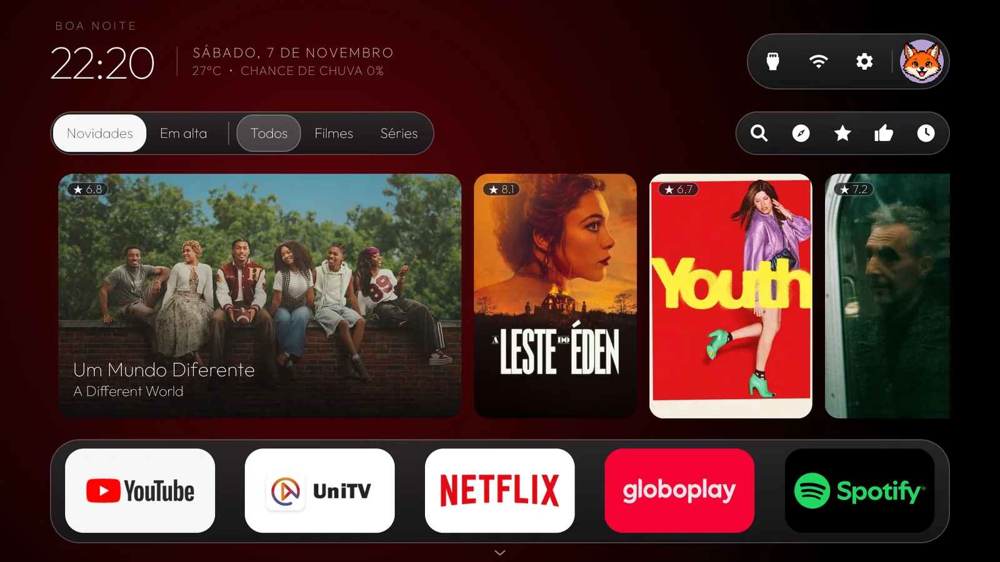

<div align="center">

  

  # PIXEL TV
  ### Uma Home com alma de cinema para Android TV e Google TV

  Catálogo oficial do **IMDb** com aviso de disponibilidade nos apps instalados na sua TV, recomendações por afinidade individual, busca por voz, trailers embutidos e automação direta para seus streamings — **100% código aberto e zero telemetria**.

  <p>
    <a href="https://thereyzer.github.io/Pixel-TV/">
      
    </a>
    <a href="https://github.com/TheReyzer/Pixel-TV/releases">
      
    </a>
    <a href="https://thereyzer.github.io/Pixel-TV/#instalacao">
      
    </a>
  </p>

  <p>
    <a href="https://thereyzer.github.io/Pixel-TV/"><strong>🌐 Site Oficial & Demonstração Interativa</strong></a> ·
    <a href="https://thereyzer.github.io/Pixel-TV/#galeria">Galeria de Telas</a> ·
    <a href="https://thereyzer.github.io/Pixel-TV/#instalacao">Como Instalar</a> ·
    <a href="https://thereyzer.github.io/Pixel-TV/#faq">Perguntas Frequentes (FAQ)</a> ·
    <a href="https://github.com/TheReyzer/Pixel-TV/releases">Baixar APK</a>
  </p>

  <br />

  <a href="https://thereyzer.github.io/Pixel-TV/">
    
  </a>

  <sub>👆 Clique na imagem acima ou acesse <a href="https://thereyzer.github.io/Pixel-TV/"><strong>thereyzer.github.io/Pixel-TV</strong></a> para explorar todas as telas, arquitetura, FAQ e o guia interativo de instalação.</sub>

</div>

---

## 🌐 Conheça pelo Site Oficial

A apresentação completa do sistema — com prévia interativa de todas as telas, detalhes do motor de afinidade por perfil, sincronização via QR Code no Google Drive (`pasta PIXEL TV`), otimizações para TVs de **2 GB de RAM** e passo a passo de instalação — está disponível em:

👉 **[https://thereyzer.github.io/Pixel-TV/](https://thereyzer.github.io/Pixel-TV/)**

---

## Instalar com uma IA

Abra este repositório no seu assistente de programação (Claude Code, Antigravity, Cursor ou Windsurf) e envie:

```text
Clone https://github.com/TheReyzer/Pixel-TV e instale na minha Android TV/Google TV. Leia PROMPT.md, identifique a TV e siga o instalador e a verificação deste repositório. Preserve meus aplicativos, perfis e o launcher original.
```

A IA prepara o ambiente, compila, instala e verifica. Você precisa habilitar a depuração e autorizar o computador na TV; alguns modelos exigem pareamento ADB com código. Essas autorizações pertencem ao Android e não podem ser puladas.

O roteiro está em [PROMPT.md](PROMPT.md), e os comandos em [docs/INSTALL.md](docs/INSTALL.md).

## Compatibilidade

- Android TV/Google TV, **Android 8/API 26 ou superior**, com instalação de APK e ADB autorizados.
- Validado fisicamente em TCL BeyondTV, Android 9. Outras marcas precisam da conferência por capacidade; não há garantia de todo recurso em qualquer modelo.
- Samsung Tizen e LG webOS não executam este APK. Fire TV e sistemas com Home bloqueada não fazem parte da validação atual.
- Entradas, canais, volume, voz e abertura de conteúdo em outro app dependem das interfaces e permissões do fabricante/aplicativo.
- Interface e catálogo priorizam PT-BR e disponibilidade brasileira. Fontes externas podem limitar ou mudar suas respostas.

Veja [docs/COMPATIBILITY.md](docs/COMPATIBILITY.md) e [docs/RECOMENDACOES.md](docs/RECOMENDACOES.md) (como funcionam os pesos e regras de recomendação).

## Primeiro acesso

Instalações novas trazem **somente o Geral** e solicitam um perfil individual na primeira abertura. Informe nome, escolha animal/cor e salve. O Geral cruza os gostos; cada perfil conserva suas avaliações e listas.

Atualizações preservam perfis existentes. As contas pessoais usadas durante o desenvolvimento não fazem parte dos defaults do produto.

## Recursos

- Home contínua com três cards de mesma altura: o focado fica horizontal à esquerda, no centro ou à direita; os demais ficam verticais, com prévias nas bordas durante a navegação.
- Cada card prepara as capas horizontal e vertical em camadas separadas. A troca de formato usa fade entre as camadas, sem redimensionar as imagens durante a navegação.
- O título permanece visível no card horizontal maior, inclusive com o foco nos filtros ou aplicativos; os cards verticais ficam sem título.
- A faixa prepara os próximos cards fora da tela e acumula as setas rápidas sem reiniciar a animação em andamento.
- Ao ligar, despertar ou retornar de outro app, a Home embaralha os títulos dando mais peso à afinidade e evitando os últimos vistos. O histórico local sobrevive ao reinício; voltar dos detalhes conserva a posição.
- Capas regionais quando disponíveis, carregamento progressivo e substituição por imagem melhor, preenchendo os cards sem deformar. A imagem disponível começa a carregar sem aguardar a localização do título; novas tentativas são retomadas ao retornar ao card, e a capa já visível é conservada durante a troca pela regional.
- Saudação na primeira tela da inicialização, enquanto aplicativos e recomendações são preparados; retorno de outros aplicativos usa a Home já carregada.
- Novidades/Em alta, filmes/séries, Descobrir para uma ou mais pessoas e grade contínua.
- Busca por texto/voz integrada à barra da Home: idioma, Tudo/Filme/Série, campo de título, microfone, lupa e Voltar. Mensagens e sugestões ficam abaixo; os resultados usam a grade contínua. A lupa sem texto explora o catálogo IMDb.
- A busca anima a abertura da cápsula e a mudança de espaço dos cards quando mensagens/sugestões aparecem ou recolhem, preservando as imagens carregadas. Os estados aberto e fechado são preparados sob a saudação inicial para reduzir a pausa no primeiro uso, sem consultar o catálogo.
- Detalhes roláveis com uma faixa no estilo da Home: continuações e obras da mesma sequência, depois derivados e outros títulos relacionados. Voltar de um relacionado restaura o título, card e rolagem anteriores. Relações consultadas no Wikidata e resolvidas por identidade IMDb no catálogo, com cache local e alternativas por tema quando a fonte estiver indisponível.
- Máscaras de leitura acompanham os títulos: apenas no card horizontal da Home e no card focado da grade.
- Avaliações individuais de Odiei a Amei, assistidos e Assistir mais tarde.
- A avaliação termina após as notas das pessoas escolhidas. Grades usam seis colunas com cards maiores e rolagem contínua; Voltar focaliza a origem e um segundo toque retorna ao filtro Novidades/Em alta anterior.
- A rolagem da grade prepara as próximas duas linhas na direção da navegação, reutiliza cards recentes e adia a troca do fundo até a seleção parar.
- O fundo da grade usa 640 × 360, com troca após uma pausa na navegação; capas e fundo da Home conservam suas resoluções.
- Uma seta circular discreta à esquerda da grade retorna diretamente a Novidades/Em alta, sem ocupar a largura dos cards; a primeira coluna também permite alcançá-la pelo D-pad.
- Atalhos para conteúdo em apps instalados; deep links e continuação após perfil variam por app.
- Trailers dentro do modal, tela cheia, controles pelo D-pad e prioridade PT-BR quando disponível.
- A busca de trailers compartilha extrações em andamento, limita as tentativas de rede e reutiliza os resultados recentes; o player prepara uma reserva maior de vídeo sem aumentar o buffer inicial exigido.
- Streams progressivos compatíveis do YouTube usam transferências em blocos de 512 KB, conservando a resolução e os controles de busca do player.
- Favoritos, entradas, rede e ajustes com navegação por controle remoto.
- Atalhos de Assistidos e avaliações (estrela) e Gostos do perfil (like) na barra da Home; os dois foram retirados do menu de perfis.
- Convite opcional de avaliação após retornar de reprodução observada por pelo menos 90 segundos.

## Ambiente e comandos

Python 3.10+, JDK 17 e Android SDK com platform-tools, plataforma 34 e build-tools 34.0.0. Configure JAVA_HOME e ANDROID_HOME ou use os diretórios usuais do Android Studio. O fluxo novo usa somente a biblioteca padrão do Python.

```sh
python tools/install.py --device IP_DA_TV:PORTA --probe-only
python tools/install.py --device IP_DA_TV:PORTA --dry-run
python tools/install.py --device IP_DA_TV:PORTA --set-home
```

Sem `--set-home`, instala e abre para prévia. O instalador **não desativa nem desinstala o launcher original**. A automação e a detecção de reprodução são opcionais: use `--enable-assist` apenas se desejar os acessos de acessibilidade e notificações. `--wifi-names` concede localização para leitura de SSID quando exigido pelo Android.

## Configuração por TV

O arquivo privado device-config.json é opcional. Sem ele não há cidade/endereço fixos, apps ausentes são omitidos e a TV ao vivo é detectada por intents/apps disponíveis. Use [o exemplo](docs/device-config.example.json) e passe `--config caminho/device-config.local.json`. Coordenadas de clima são opcionais; o aplicativo não coleta GPS automaticamente.

## Testes

```sh
python -m unittest discover -s tools/tests -v
sh launcher/gradlew -p launcher testDebugUnitTest assembleDebug --console=plain
```

No Windows, use launcher/gradlew.bat. O workflow de CI executa testes e compilação; isso não substitui conferir o controle e a imagem no hardware.

## Publicação limpa

```sh
python tools/export_source.py --output dist/tv-vibehack-source --zip
```

Publique o conteúdo dessa pasta em um repositório novo. A exportação inclui fontes, assets necessários, testes e instruções; exclui histórico Git, backups das TVs, capturas locais, chaves, caches e APKs. O destino deve ser novo, para não misturar versões. Revise o conteúdo antes de publicar.

Não use git push no origin herdado sem conferir o destino. A exportação não leva esse remote. Conserve localmente a chave de assinatura para atualizar o APK; uma assinatura diferente interrompe a atualização sem apagar os perfis. Nunca publique chaves ADB ou de assinatura.

## Privacidade e restauração

[PRIVACY.md](PRIVACY.md) explica dados e permissões; [SECURITY.md](SECURITY.md) descreve cuidados e relatos privados.

Cada instalação produz backup/install-DATA/restore.json. Restaure com `python tools/install.py --device SERIAL --restore backup/install-DATA`. A restauração conserva app e perfis. Os utilitários antigos de debloat são operações manuais separadas e não fazem parte do fluxo recomendado.

## Créditos e licenças

Derivado de [Gathin23/tv-vibehack](https://github.com/Gathin23/tv-vibehack). A licença MIT e os avisos originais foram preservados em [LICENSE](LICENSE).

O aplicativo combina NewPipeExtractor, GPL-3.0-or-later. A distribuição do aplicativo combinado segue [launcher/LICENSE](launcher/LICENSE) e [launcher/COPYING](launcher/COPYING), incluindo os fontes correspondentes e avisos das dependências. Veja [THIRD_PARTY_NOTICES.md](launcher/THIRD_PARTY_NOTICES.md). Um APK desta versão não contém somente código MIT.
